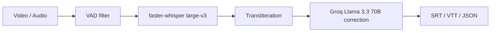
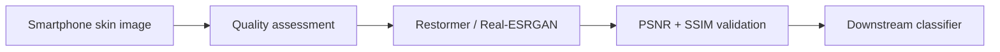

<!-- HEADER -->

  

<!-- TYPING ANIMATION -->

  

<!-- BADGES -->

  
  
  

  
  
  

---

## 🪔 Kaun Hai Ye? 

> **"Build robust pipelines. Validate before trusting."** 💅

AI & ML undergrad at **CMR Institute of Technology, Bengaluru**. I build systems that survive the jump from *"works on my laptop"* to *"works in production"*, especially when the audio is noisy, the language is half Hindi and half English, and the images are blurry.

| | |
|---|---|
| 🎙️ **Building** | **CapFlow**: Hinglish code-switching captions (`faster-whisper` + dynamic transliteration + Groq/Llama 3 post-processing) |
| 🔬 **Researching** | **DermaLens**: domain-aware AI middleware for dermatological image enhancement and quality assessment (Restormer, Real-ESRGAN) |
| 🌱 **Deep diving** | ASR, multilingual code-switching, speech separation, image restoration |
| ☕ **Chai pe charcha** | PyTorch, Whisper, Groq/LLM pipelines, OpenCV, FastAPI, React, noisy audio/visual signals |

### 👑 Highlights

- 📜 Patent filed: Indian Patent App. No. `202641024127`
- 🥇 Finalist, **MSME IDEA Hackathon 4.0**
- 🎓 Student Placement Coordinator at CMRIT

---

## 💻 Tech Stack 

  

  
  
  
  
  
  

---

## 🚀 Featured Projects 

<table>
  <tr>
    <td width="50%" valign="top">

### 🎙️ CapFlow
*Intelligent Code-Switching (Hinglish) Captioning Pipeline*

Turns mixed Hindi + English speech into production-ready **Romanized Hinglish** captions, with no phonetic degradation and no Devanagari lock-in.

- **ASR:** CTranslate2-optimized `faster-whisper-large-v3` with VAD pre-filtering and word-level timestamps
- **LLM correction:** multi-model failover layer on Groq (Llama 3.3 70B) for zero-shot loanword normalization
- **Export:** `.srt`, `.vtt` and structured `.json`

</td>
    <td width="50%" valign="top">

### 🧠🩺 DermaLens
*Domain-Aware AI Middleware for Dermatological Image Enhancement*

Adaptively corrects blur, noise and lighting defects in smartphone-captured skin images **before** downstream medical classification.

- **Core:** PyTorch, OpenCV, Restormer, Real-ESRGAN
- **Validation:** objective PSNR and SSIM evaluation built into the processing steps
- **Architecture:** FastAPI microservice with a clean React frontend

</td>
  </tr>
</table>

### 🔧 Under the hood

---

## 📈 Stats 

  
  
  

  

🐍 Contribution snake

 

  

---

## 🌐  *(Let's Connect)*

  Open to <b>placements and off-campus roles</b> in AI/ML, speech and computer vision. 
  If your audio is noisy or your images are blurry , Voila ! I'm here.
  <a href="mailto:stutikatiyarof@gmail.com">📧 Email</a> &nbsp;•&nbsp;
  <a href="https://linkedin.com/in/stutikt">💼 LinkedIn</a> &nbsp;•&nbsp;
  <a href="https://github.com/stutikatiyar">🐙 GitHub</a> &nbsp;•&nbsp;
  <a href="https://leetcode.com/STUTIKATIYAR">🧩 LeetCode</a>

